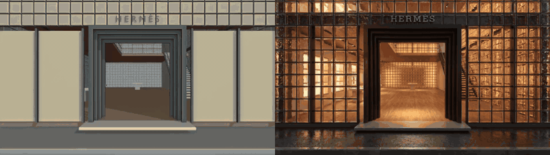

# Blender Previs + FLORA

**Turn your reference pictures and camera idea into a quick 3D preview video.**

Tell your AI what kind of shot you want: a slow walk through a building, a camera swooping over a set, a move through a doorway. It builds a simple, editable 3D version of the space in Blender and gives you a short preview video of the camera move. Preview first, then decide if you want a finished, photorealistic AI video made from it.

- Your original reference pictures are never changed.
- The 3D scene is yours to open, tweak and reuse in Blender.
- Nothing is spent on AI video unless you say so.
- Preview videos are small and quick to make, so you can try lots of camera moves.

## See it work

A real shot from the Hermès Tokyo store previs. **Left is the Blender white-box (before). Right is the AI render (after).** Same camera move, same timing.



Full-quality clips, with no sound:

- **Before (Blender white-box):** [before-whitebox-3d.mp4](docs/media/before-whitebox-3d.mp4)
- **After (AI render):** [after-ai-render.mp4](docs/media/after-ai-render.mp4)

> **Heads up:** the white-box is deliberately plain grey and white. It shows *where things are and how the camera moves*, not how they will look. The realistic look is added in the optional AI step, and the camera move stays the same.

---

## What you need

1. **An AI assistant that can work with files on your computer.**
   Claude (Claude Code or the Claude desktop app) or ChatGPT's Codex both work.
   A plain chat window that only lets you type back and forth is not enough.
2. **Blender** (free 3D software). Download it from [blender.org](https://www.blender.org/download/). Version 4.5 or newer is recommended.
3. **FFmpeg** (free video tool). This is what turns the preview into a video file. Not sure you have it? Skip it. Your AI will check, and install it for you if it's missing.
4. **Your reference pictures**: a few photos or screenshots of the place, and a note on how you want the camera to move.
5. *Optional, only for the AI video step:* a **FLORA** account connected to your AI. FLORA is what makes the finished photorealistic video. Generating video costs money, so this step only runs when you ask for it.

That's it. You do not need to type any code yourself.

---

## Install it (3 steps)

### Step 1. Download

Download the whole folder. On GitHub, click the green **Code** button, then **Download ZIP**.

Don't just grab the `SKILL.md` file. The skill needs all the folders that come with it.

### Step 2. Unzip

Double-click the ZIP. You'll get a folder called `blender-previs-with-flora`. Put it somewhere easy to find, like your Desktop or Documents.

### Step 3. Tell your AI where it is

Open your AI assistant and paste the message below. Change the parts in `CAPITAL LETTERS`.

```text
Read the file SKILL.md inside my "blender-previs-with-flora" folder at
PATH-TO-BLENDER-PREVIS-FOLDER and set it up for me as a skill.

Check that Blender and FFmpeg are installed on my computer. If either is
missing, tell me and help me install it.
```

**How do I get a "path"?**

- **Mac:** right-click the folder, hold the **Option** key, then click
  **Copy "name" as Pathname**.
- **Windows:** hold **Shift**, right-click the folder, then click **Copy as path**.

Paste that where the CAPITAL LETTERS are.

The first time, your AI may install a few small helper tools. This can take a few minutes.

---

## Make your first preview

Once it's set up, describe the shot in plain language and attach your reference pictures. For example:

> Use the blender-previs skill. Here are three reference photos of the building.
> Start outside on the street, walk slowly toward the entrance, then reveal the
> big staircase inside. Make it about 8 seconds and give me a quick preview.

Your AI will:

1. Build a simple 3D version of the space.
2. Plan the camera move and check that it doesn't pass through walls.
3. Render a short preview video (720p, 8 seconds by default).
4. Show you the results and tell you where the files are.

**People in the shot** show up as simple stand-ins: a plain cylinder (or box) at the right height, not a jointed mannequin. That is enough to show where they stand and how they move. The realistic person is added later in the optional AI step. If you do want arms and legs, say so in your request.

Want a different camera move? Just say so: *"Keep the same path, but end looking left instead."* It will change only what you asked for.

---

## What you get

Your files are saved in a folder for this shot:

| What | What it's for |
| --- | --- |
| **Preview video** (`.mp4`) | The camera move. Watch it, share it, or use it as a guide. |
| **3D scene** (`.blend`) | The editable Blender file. Open it in Blender to move walls, change the camera, or make new camera versions. |
| **Review pictures** (`.png`) | Still frames from the move, so you can check the shot quickly. |
| **Production notes** (`.md`) | A short log of what was decided and what changed. |

---

## Add the AI video (optional)

When you're happy with the preview, ask for the finished version:

> Continue to the AI video. Use the preview I just approved.

Before anything costs money, your AI will:

1. Show you two styled still images, the first and last frame, so you can say "yes" or change them.
2. Ask you two quick questions: **resolution** (480p, 720p or 1080p) and **quality** (Standard or High).
3. Give you a cost estimate and wait for your go-ahead.

Nothing is generated until you say yes.

---

## Keep it simple

- **Start small.** A short shot and a few reference pictures is enough to begin.
- **Keep your reference pictures in one folder.** It makes it easier to ask for changes.
- **Ask for changes in plain words.** "Move the camera higher," "make it slower," "end on the pillar."
- **Don't share private things.** The folder should not contain your passwords, account IDs, or client photos you aren't allowed to share.

---

## If something goes wrong

| What you see | What to do |
| --- | --- |
| "Blender not found" | Install Blender from [blender.org](https://www.blender.org/download/), then ask your AI to try again. |
| "ffmpeg not found" | Ask your AI: *"Help me install FFmpeg."* |
| "Output folder already exists" | Ask for a new name, like `shot01-v2`. Old renders are never overwritten. |
| The camera goes through a wall | Ask your AI to *"raise the camera"* or *"widen the doorway."* |
| The preview looks confusing | Ask for the review pictures first, then describe what looks wrong. |
| The AI video step says it can't connect | Check that your FLORA account is connected to your AI, then try again. The preview still works without it. |

Still stuck? Copy the error message and paste it to your AI. It can usually fix it for you.

---

## For developers

Full skill instructions are in **[SKILL.md](SKILL.md)**. Helpers and references:

| Path | Purpose |
| --- | --- |
| `SKILL.md` | Skill definition and full workflow |
| `agents/openai.yaml` | Display name and default prompt for the agent UI |
| `references/camera-motion.md` | Camera path, aim, and clearance techniques |
| `references/characters.md` | Cylinder/box character stand-ins and when to use a limbed figure |
| `references/rendering.md` | Render helper invocation and failure handling |
| `references/flora-workflow.md` | Previs-to-video steps on the FLORA canvas |
| `scripts/render_preview.py` | Runs inside background Blender: storyboard frames or full MP4 |
| `scripts/extract_endpoints.py` | Extracts exact first/last decoded frames via FFmpeg |

**Requirements:** Blender (helper tested with 4.5.4), Python 3, FFmpeg and FFprobe on `PATH`, and a connected FLORA MCP for the AI stage only. Blender MCP is optional.

**Example helper calls** (paths and names are examples):

```bash
# Storyboard frames
Blender --background scenes/previs.blend --python-exit-code 1 \
  --python scripts/render_preview.py -- \
  --scene "PREVIS" --camera "CAM 01" --output renders/shot01/storyboard_r01 --frames 1,111,192

# First/last frames of a rendered preview
python3 scripts/extract_endpoints.py preview.mp4 --output endpoints-v01
```

Both helpers refuse to reuse an existing output directory. See `references/rendering.md` for the full-export invocation.

The media in `docs/media/` is a lightweight, silent 960px derivative of the Hermès entrance dolly shot: `before-whitebox-3d.mp4` from the Blender preview, `after-ai-render.mp4` from the styled final, and `before-after.gif` placed side by side. Originals stay in the Hermès project.

## Notes

- The skill does not install software, transfer account access, or include generation credits.
- Keep personal workspace IDs, project assets, client photos, and credentials out of the shared folder.

## License

No license file has been added yet. Ask the repository owner before reusing this skill.
